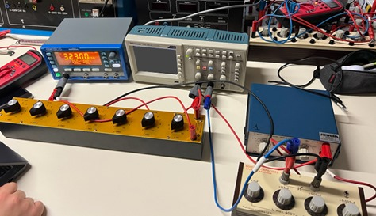
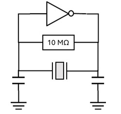
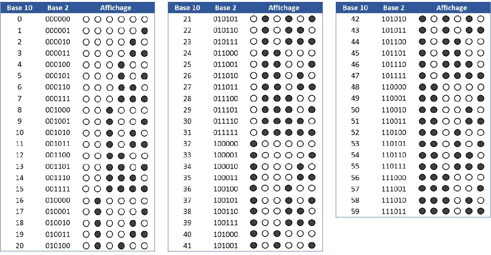

# TIPE: quartz oscillators and a binary Arduino watch

My TIPE, the research project we do in French prépa (MP, EMC2 Hadamard, 2025). The question was: why are quartz oscillators so precise, and how does a quartz watch use the piezoelectric effect? The year's theme was "transition, transformation, conversion".

The project has three parts: modelling the quartz, measuring it in the lab, and building a small watch with an Arduino that shows the seconds in binary.

## 1. Modelling

**Piezoelectricity.** Quartz has no centre of symmetry. When you compress it, the centres of the positive (Si) and negative (O) charges in each cell move apart, and a voltage appears (direct effect). The other way round, applying a voltage makes the crystal deform (inverse effect).

**Mass-spring-damper model.** A vibrating part of the crystal can be modelled as

$$m\ddot{x} + h\dot{x} + kx = \alpha\,U(t)$$

which gives a natural frequency of $\omega_0 = \sqrt{k/m}$. Damping is very small in a well-cut crystal.

**Equivalent circuit.** Using the analogy between mechanics and electricity (force ↔ voltage, speed ↔ current), the quartz becomes a series RLC branch in parallel with a capacitor $C_p$ (the electrodes). This circuit has two resonances:
- series: $\omega_s = 1/\sqrt{LC}$
- parallel: $\omega_p = \omega_s\sqrt{1 + C/C_p}$, where the admittance becomes real

The relative gap between the two is only about 0.1 %. The quartz only oscillates in a very narrow frequency band, which is what makes it such a good time base.

## 2. Experiments

- Showing the direct and inverse piezoelectric effect
- Finding the resonance of a 32,768 Hz watch quartz: I swept the frequency with a signal generator and recorded the voltage
- Building an RC oscillator and a quartz oscillator, and comparing how stable their frequencies are (the quartz wins by far)

  
  &nbsp;
  

## 3. The binary watch

A Pierce oscillator (an inverter, a 10 MΩ resistor, the quartz and two capacitors) produces a 32,768 Hz signal, which goes to pin D2 of an Arduino:
1. an interrupt counts the rising edges
2. every 32,768 = 2¹⁵ pulses, one second has passed
3. the seconds (0 to 59) are shown in binary on 6 LEDs, and another LED blinks every second

The code is in [`binary_watch/binary_watch.ino`](binary_watch/binary_watch.ino).

## Slides

[Presentation (in French)](docs/slides_quartz_oscillators_FR.pdf)
